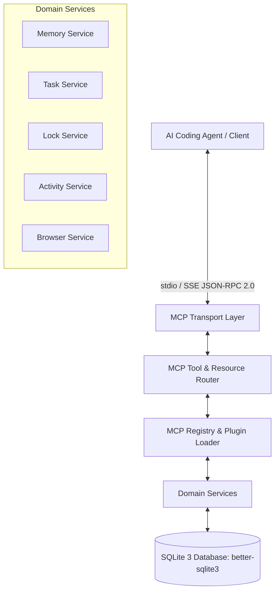

# Architecture Overview — local-mcp-memory v2.6.0

## System Architecture

## Key Components
- **Transport Layer (`mcp-server.js`, `server.js`):** Handles JSON-RPC 2.0 stdio communication and Express 5 Server-Sent Events.
- **Registry & Router (`src/core/mcp-registry/`):** Manages dynamic registration and routing for 63 tools and resources.
- **Database Engine (`src/core/database/sqlite/`):** Manages SQLite connection pooling, migrations, WAL mode, and schema integrity across 16 tables.
- **Migration Engine (`src/core/migration/`):** Facilitates zero-loss data translation from legacy MongoDB instances to SQLite.
