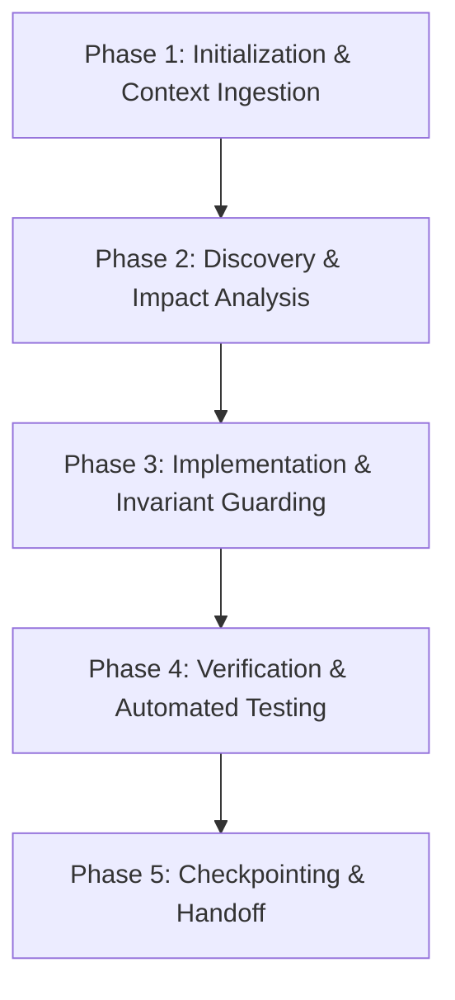

# Universal Agent Workflow Protocol

Every AI agent operating on this repository must execute tasks using this standardized 5-phase lifecycle:

### Phase 1: Initialization & Context Ingestion
- Read the root pointer (`AGENTS.md`).
- Ingest `.agent/context/CURRENT_STATE.md` and `.agent/context/ACTIVE_WORK.md`.
- Review recent entries in `.agent/memory/SESSION_LOG.md` and check `.agent/memory/HANDOFF.md`.

### Phase 2: Discovery & Impact Analysis
- Inspect existing code and tests related to the target feature or bug.
- Verify that changes will not alter public MCP tool schemas or break client connections.

### Phase 3: Implementation & Invariant Guarding
- Make atomic, focused edits.
- Ensure all new files are pure ESM with `.js` or `.mjs` extensions.
- Adhere to the error handling principles in `.workspace/LFI/ERROR_PATHS.md`.

### Phase 4: Verification & Automated Testing
- Run syntax validation: `npm run check`.
- Run unit and integration tests: `npm test`.
- Verify domain-specific test suites if applicable (`test:resilience`, `test:isolation`, `test:contract`).

### Phase 5: Checkpointing & Handoff
- Append a concise summary of changes to `.agent/memory/SESSION_LOG.md`.
- Update `.agent/memory/HANDOFF.md` with active state and next steps.
- If documentation was affected, update `.workspace/PRI/PROJECT_REFERENCE_INDEX.md`.
