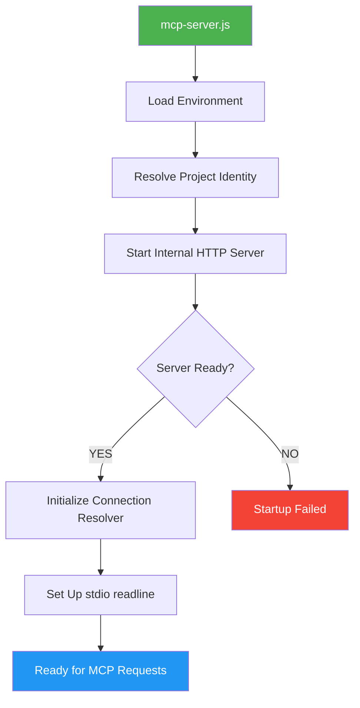
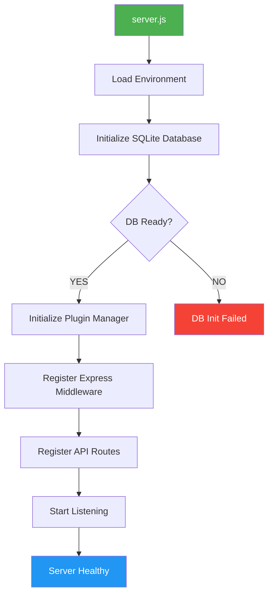
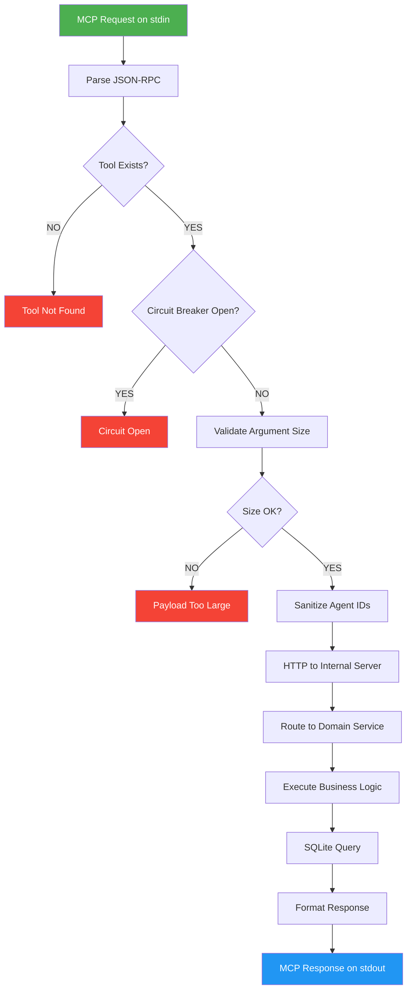
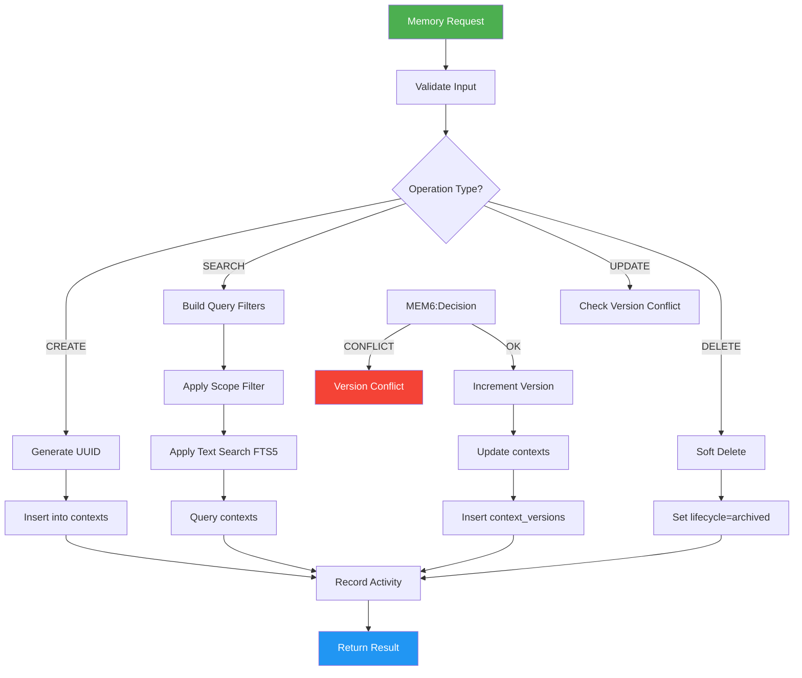
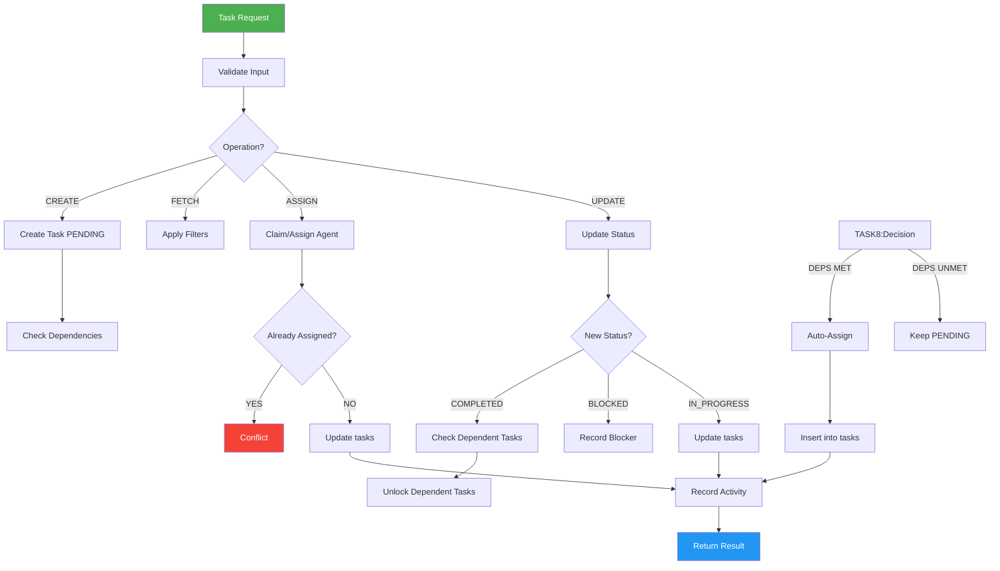
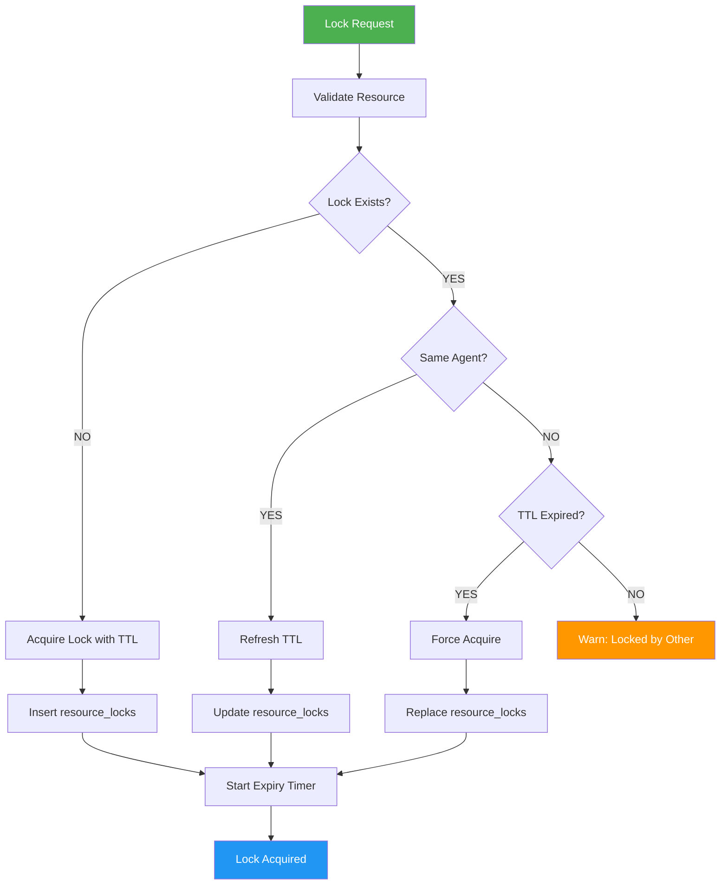
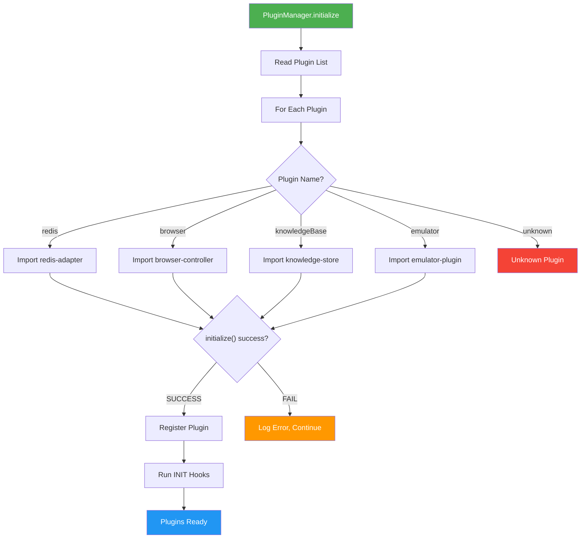
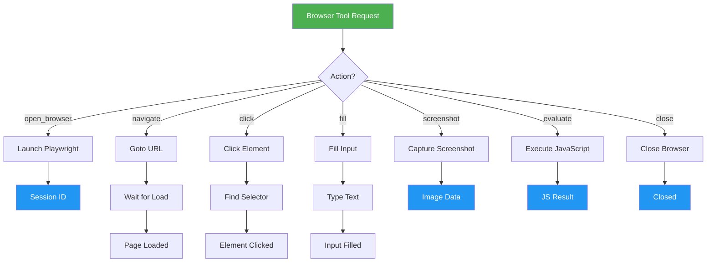

# Diagrams — Logic Flow Index

**Project:** local-mcp-memory
**Version:** 2.6.0
**Last Updated:** 2026-09-19

---

## Node ID Convention

All diagrams use stable, traceable node IDs:

```
[Component][SequentialNumber]:[Type][Name]

Components:
  START  — Server startup
  TOOL   — MCP tool execution
  MEM    — Memory operations
  TASK   — Task coordination
  LOCK   — Soft lock operations
  PLUGIN — Plugin system
  BROWSER— Browser automation
  ERR    — Error handling

Types:
  Entry    — Starting point
  Process  — Processing step
  Decision — Branching point (diamond)
  Output   — Result/return
  Error    — Error handling path
  External — External service call
```

---

## Startup Flow

### MCP Server Startup



**Node ID → Source:**

- `START1:Entry` → `mcp-server.js:1`
- `START2:Process` → `mcp-server.js:23-26`
- `START3:Process` → `mcp-server.js:38-41`
- `START4:Process` → `mcp-server.js:58`
- `START5:Decision` → `startMemoryServer.js:6-23`
- `START6:Process` → `mcp-server.js:59-64`
- `START7:Process` → `mcp-server.js:32-36`
- `START8:Output` → `mcp-server.js:ready state`

### HTTP API Server Startup



**Node ID → Source:**

- `START1:Entry` → `server.js:1`
- `START3:Process` → `server.js:5` (import initializeDatabase)
- `START4:Decision` → `server.js` (DB initialization check)
- `START5:Process` → `core/plugin/plugin-manager.js:17`
- `START6:Process` → `server.js` (middleware registration)
- `START7:Process` → `server.js` (route registration)
- `START8:Process` → `server.js` (listen call)

---

## Tool Execution Flow



**Node ID → Source:**

- `TOOL1:Entry` → `mcp-server.js` (readline handler)
- `TOOL2:Process` → `mcp-server.js` (JSON.parse)
- `TOOL3:Decision` → `src/core/mcp/tool-registry.js:27` (hasTool)
- `TOOL4:Decision` → `mcp-server.js:99-108` (circuit state)
- `TOOL5:Process` → `mcp-server.js:75-76` (RELIABILITY config)
- `TOOL7:Process` → `mcp-server.js:96-97` (AGENT_ID validation)
- `TOOL8:External` → `mcp-server.js` (HTTP fetch to server.js)
- `TOOL9:Process` → `src/core/mcp/tool-executor.js:14` (execute)
- `TOOL11:External` → `src/core/database/sqlite/index.js`

---

## Memory Flow



**Node ID → Source:**

- `MEM1:Entry` → `utils/memoryEngine.js`
- `MEM2:Process` → `utils/security-validators.js` (validateInput)
- `MEM4:Process` → `utils/memoryEngine.js` (uuid generation)
- `MEM5:Process` → `src/domains/memory/memory.service.js:31` (searchContexts)
- `MEM6:Decision` → `utils/memoryEngine.js` (detectAndResolveMemoryConflicts)
- `MEM8:External` → `src/core/database/sqlite/collection.js` (insertOne)
- `MEM10:Process` → `src/core/database/sqlite/query-builder.js` (FTS5)
- `MEM12:Process` → `utils/memoryEngine.js` (updateContextWithVersioning)
- `MEM16:Process` → `utils/activityTracker.js` (recordActivity)

---

## Task Flow



**Node ID → Source:**

- `TASK1:Entry` → `utils/coordinationEngine.js`
- `TASK4:Process` → `src/domains/task/task.service.js`
- `TASK8:Process` → `utils/coordinationEngine.js` (buildTaskSchedule)
- `TASK9:Process` → `utils/coordinationEngine.js` (autoAssignTask)
- `TASK12:Decision` → `utils/coordinationEngine.js` (assignment check)
- `TASK14:Decision` → `src/domains/task/task.service.js` (status transition)
- `TASK15:Process` → `utils/coordinationEngine.js` (dependency resolution)

---

## Lock Flow



**Node ID → Source:**

- `LOCK1:Entry` → `utils/collaborationEngine.js`
- `LOCK3:Decision` → `utils/collaborationEngine.js` (listResourceLocks check)
- `LOCK4:Process` → `utils/collaborationEngine.js` (acquireResourceLock)
- `LOCK5:Decision` → `utils/collaborationEngine.js` (agent comparison)
- `LOCK7:Decision` → `utils/collaborationEngine.js` (TTL check)
- `LOCK13:Process` → `utils/collaborationEngine.js` (cleanupExpiredLocks timer)

---

## Plugin Flow



**Node ID → Source:**

- `PLUGIN1:Entry` → `core/plugin/plugin-manager.js:17`
- `PLUGIN2:Process` → `core/plugin/plugin-manager.js:22` (getPluginList)
- `PLUGIN4:Decision` → `core/plugin/plugin-manager.js:42-57` (switch)
- `PLUGIN5-8:External` → `core/plugin/plugin-manager.js:44-55` (dynamic imports)
- `PLUGIN10:Decision` → `core/plugin/plugin-manager.js:62-63` (initialize check)
- `PLUGIN11:Process` → `core/plugin/plugin-manager.js:66-68` (register)
- `PLUGIN13:Process` → `core/plugin/plugin-manager.js:28` (\_runHook INIT)

---

## Browser Automation Flow



**Node ID → Source:**

- `BROWSER1:Entry` → `tools/browserTools.js`
- `BROWSER3:Process` → `tools/browserTools.js` (open_browser handler)
- `BROWSER4:Process` → `tools/browserTools.js` (navigate_to_url handler)
- `BROWSER5:Process` → `tools/browserTools.js` (click_element handler)
- `BROWSER7:Process` → `tools/browserTools.js` (take_screenshot handler)
- `BROWSER8:Process` → `tools/browserTools.js` (evaluate_javascript handler)

---

## Reference Maintenance Log

### 2026-09-19

**Change:** Initial diagrams creation

**Classification:** ADDED

**Updated:**

- Created 7 Mermaid diagrams with stable node IDs
- Documented node ID → source code traceability
- All diagrams follow `[Component][Seq]:[Type][Name]` convention

**Verification:** FULL

---

_All diagrams use stable node IDs traceable to source code. Update when execution flows change._
