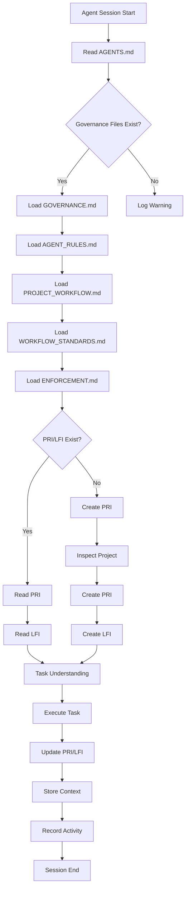
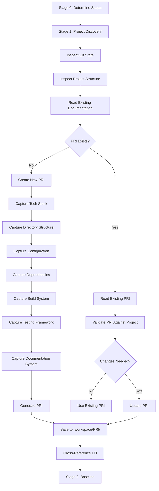
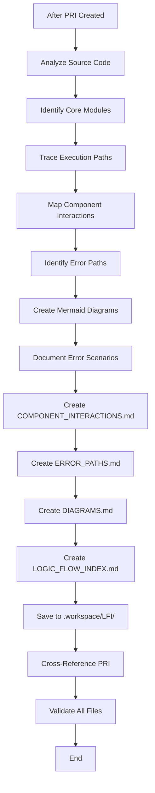
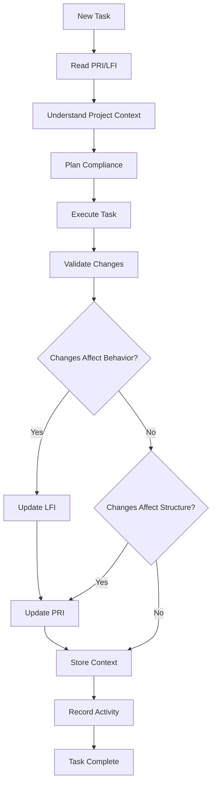
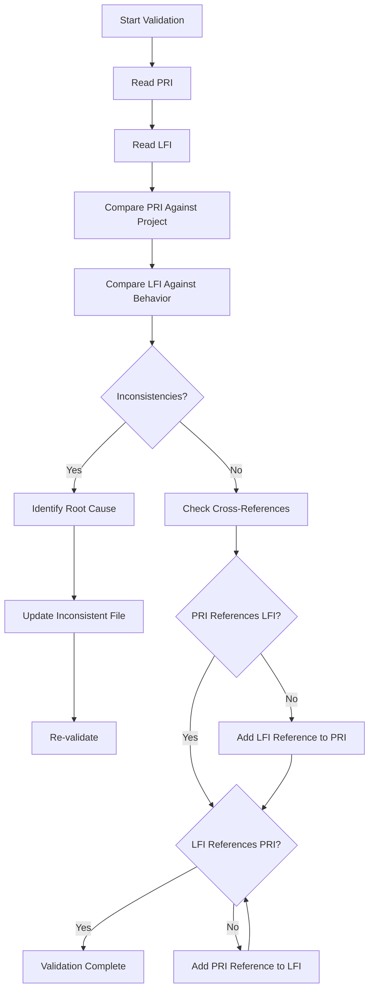
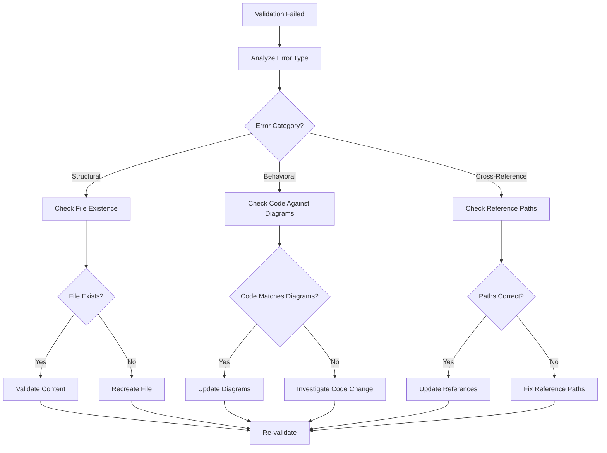
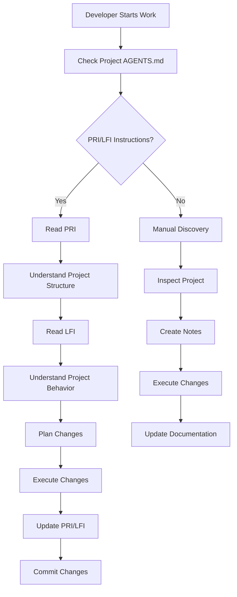
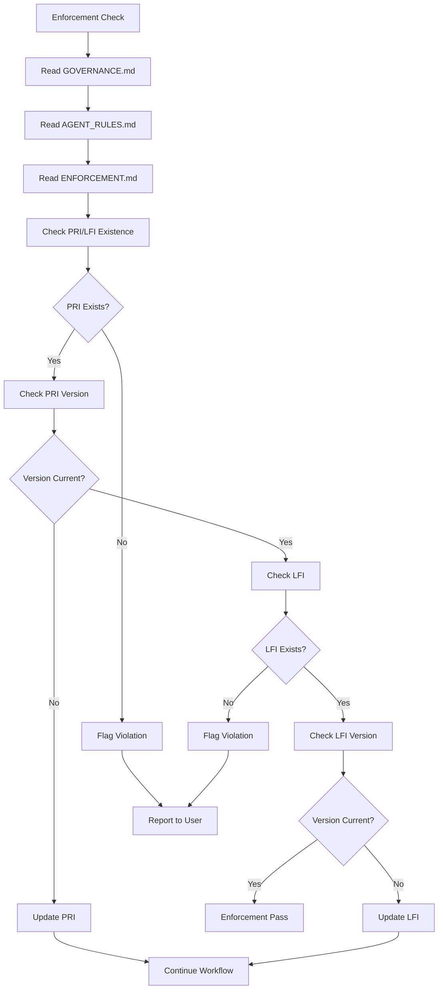

# PRI/LFI Flow Visualizer

## Master Flow — Agent Decision Architecture

## PRI Lifecycle — Structural Reference Creation

## LFI Lifecycle — Behavioral Reference Creation

## Task Execution Flow — Agent Workflow

## Cross-Reference Validation Flow

## Error Recovery Flow — When Validation Fails

## Development Team Access Points

## Governance Enforcement Flow

## Quick Reference — File Locations

| File                         | Location          | Purpose                           |
| ---------------------------- | ----------------- | --------------------------------- |
| `PROJECT_REFERENCE_INDEX.md` | `.workspace/PRI/` | Structural map of the project     |
| `LOGIC_FLOW_INDEX.md`        | `.workspace/LFI/` | Behavioral map of the project     |
| `DIAGRAMS.md`                | `.workspace/LFI/` | Visual Mermaid diagrams           |
| `COMPONENT_INTERACTIONS.md`  | `.workspace/LFI/` | Component dependency maps         |
| `ERROR_PATHS.md`             | `.workspace/LFI/` | Error scenario documentation      |
| `FLOW_VISUALIZER.md`         | `.workspace/LFI/` | This file — visual flow reference |
