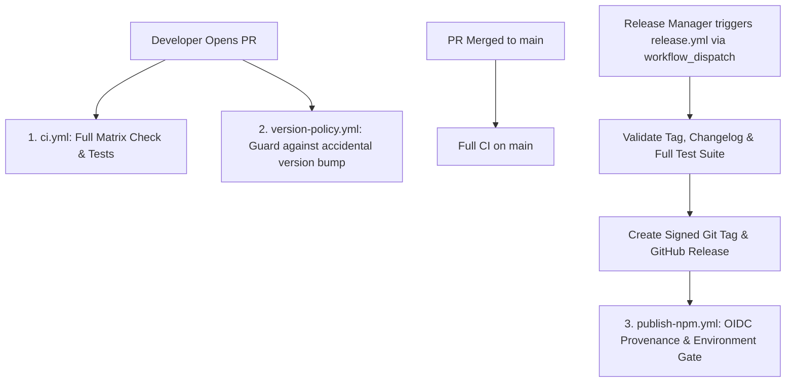

# Report 09: Proposed Modern GitHub Workflow Architecture

**Project:** `local-mcp-memory`  
**Target Release:** `v2.6.1`  
**Date:** 2026-11-07  
**Auditor:** Google Antigravity  

---

## 1. Architectural Principles

The proposed workflow architecture for v2.6.1 enforces three foundational principles:
1. **Zero Unintended Releases:** No tag, release, or package publication can ever occur automatically from an ordinary pull request or branch push.
2. **Comprehensive Verification Before Merge:** CI runs the full 242-assertion regression suite across a matrix of Node.js 20 and 22 on both Ubuntu and Windows.
3. **Secure npm Provenance via OIDC:** npm publishing is decoupled from local developer credentials, executing via GitHub OIDC trusted publishing with GitHub Environments approval protection.

---

## 2. Target Workflow Suite Specification

### 1. `ci.yml` (Enhanced Matrix CI)
- **Triggers:** `push: [main, develop]`, `pull_request: [main, develop]`.
- **Matrix Strategy:**
  - `os: [ubuntu-latest, windows-latest]`
  - `node-version: [20.x, 22.x]`
- **Required Steps:**
  1. `npm ci`
  2. `npm run check` (Syntax check across all 63 JS files)
  3. `npm run lint` & `npm run format:check`
  4. `npm test` (Core 120 assertions)
  5. `npm run test:resilience` (19 assertions)
  6. `npm run test:isolation` (18 assertions)
  7. `npm run test:contract` (28 assertions)
  8. `npm run test:gaps` (11 assertions)
  9. `npm run test:execution` (40 assertions)
  10. `node --test tests/workspace-governance-test.mjs` (6 assertions)
  11. `node scripts/verify-disposable-package-install.mjs` (Clean-room pack & stdio handshake test)

### 2. `version-policy.yml` (Version Protection Gate)
- **Triggers:** `pull_request: [main, develop]`.
- **Function:** Inspects `git diff origin/main...HEAD package.json`. If `version` changed, the job fails unless:
  - The PR has the label `release` OR
  - The branch name begins with `release/` OR
  - The PR author is explicitly permitted in repository variables.
- **Benefit:** Completely eliminates accidental version bumps in ordinary bugfix or feature PRs.

### 3. `release.yml` (Controlled Release Orchestrator)
- **Triggers:** `workflow_dispatch` (Manual trigger with inputs: `version`, `dry-run`, `draft`).
- **Decommissioning:** **Permanently delete `auto-tag.yml`.**
- **Lifecycle Steps:**
  1. Verify working branch is `main` and clean.
  2. Assert version matches SemVer (`^[0-9]+\.[0-9]+\.[0-9]+$`).
  3. Run full CI test suite.
  4. Verify `CHANGELOG.md` contains an entry for the target version.
  5. Update `package.json` and `package-lock.json` via `npm version <v> --no-git-tag-version`.
  6. Commit and create annotated Git tag `v<version>`.
  7. Generate GitHub Release with changelog release notes.
  8. Attach packed tarball (`local-mcp-memory-<v>.tgz`) as a release asset.

### 4. `publish-npm.yml` (OIDC Trusted Publishing)
- **Triggers:** `release: [published]` OR `workflow_dispatch`.
- **Permissions:** `id-token: write`, `contents: read`.
- **Environment:** Protected environment `npm-release` (requires repository admin sign-off).
- **Execution:**
  1. Checkout release tag.
  2. Setup Node.js with registry `https://registry.npmjs.org/`.
  3. Run `npm pack --dry-run` and verify tarball contents.
  4. Publish with provenance: `npm publish --provenance --access public`.
