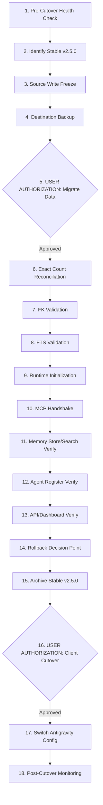

# Report 09: Controlled Cutover Runbook

**Project:** local-mcp-memory  
**Version:** 2.6.0  
**Campaign:** Campaign 10 — Final Release Readiness, Production Migration Preflight & Controlled Cutover Authorization  
**Date:** 2026-11-06  
**Auditor:** Google Antigravity  
**Status:** COMPLETE / AWAITING AUTHORIZATION  

---

## 1. Operational Cutover Milestones

| Milestone | Meaning | Status |
| :--- | :--- | :--- |
| **Engineering Ready** | Code and tests meet acceptance criteria (242/242 passing) | **ACHIEVED** |
| **Release Candidate Ready**| Package and documentation verified via clean-room install | **ACHIEVED** |
| **Migration Ready** | Migration preflight, backup, and dry-run verified | **ACHIEVED** |
| **Migration Authorized** | User explicitly approves production data migration | **AWAITING USER COMMAND** |
| **Migration Completed** | Data successfully migrated and reconciled | PENDING STEP 5 |
| **Cutover Authorized** | User explicitly approves switching operational clients | **AWAITING USER COMMAND** |
| **Production Active** | v2.6.0 is the verified operational instance | PENDING STEP 16 |

---

## 2. Step-by-Step Operational Runbook (18 Steps)

1. **Step 1:** Pre-cutover health check (`npm test`). Requires exit code 0.
2. **Step 2:** Verify stable v2.5.0 directory path is intact.
3. **Step 3:** Request brief user pause on memory-generating agent tasks (write-freeze).
4. **Step 4:** Execute destination SQLite backup to `.backups/sqlite-backup-<timestamp>.db`.
5. **Step 5 (GATE 1):** Obtain explicit user authorization for data migration (`--apply`).
6. **Step 6:** Execute migration and assert exact count parity.
7. **Step 7:** Run `PRAGMA foreign_key_check` (must report 0 errors).
8. **Step 8:** Run FTS5 search query test.
9. **Step 9:** Initialize v2.6.0 background runtime.
10. **Step 10:** Execute MCP JSON-RPC stdio handshake.
11. **Step 11:** Test storing and retrieving a verification memory.
12. **Step 12:** Verify agent registration and heartbeat.
13. **Step 13:** Check HTTP API health at `http://127.0.0.1:3799/health`.
14. **Step 14:** Assess rollback decision criteria (all green -> proceed).
15. **Step 15:** Retain stable v2.5.0 as an archived rollback backup.
16. **Step 16 (GATE 2):** Obtain explicit user authorization for agent configuration cutover.
17. **Step 17:** Update global Antigravity `mcp_config.json` to target v2.6.0.
18. **Step 18:** Monitor initial live sessions for 24 hours.
