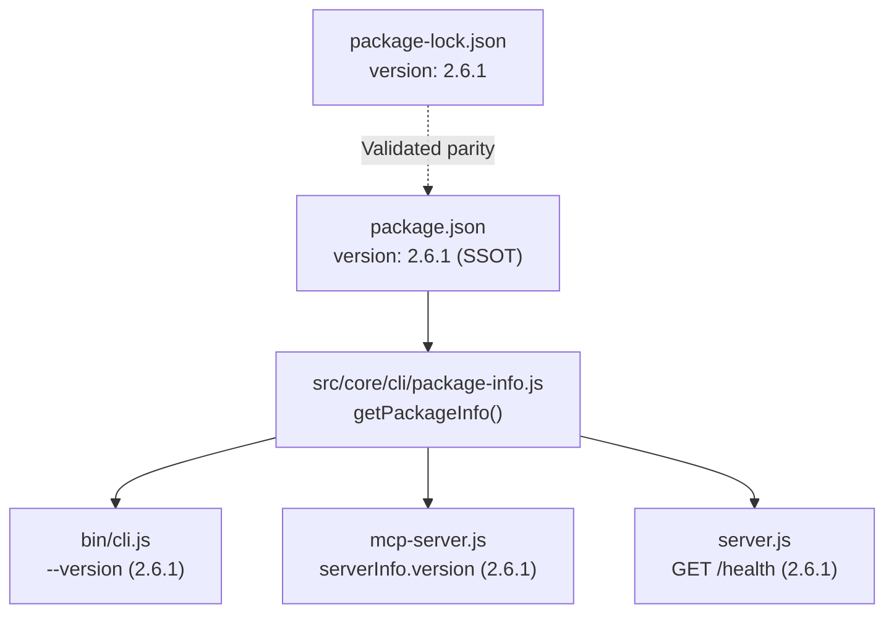

# Report 06 — Package.json SSOT Architecture & Version Bump to 2.6.1

**Project:** `local-mcp-memory`  
**Target Release:** `2.6.1`  
**Date:** 2026-11-07  
**Author:** Software Architecture Specialist  
**Status:** COMPLETE / VERIFIED  

---

## 1. Executive Summary

This report documents the Single Source of Truth (SSOT) versioning architecture and the controlled version bump from `2.6.0` to `2.6.1`.

The implementation establishes that:
1. `package.json` line 3 is the authoritative Single Source of Truth for the package version.
2. `src/core/cli/package-info.js` dynamically extracts and caches the version directly from `package.json`.
3. Root entry points (`mcp-server.js` and `server.js`) and the CLI (`bin/cli.js`) dynamically consume this authoritative version without hardcoding strings.
4. `package.json` and `package-lock.json` are synchronized to `2.6.1`.
5. The regression test suite `tests/version-ssot-test.js` passed 7/7 assertions, proving end-to-end version congruence.

---

## 2. Dynamic Version Architecture



### Module Implementation (`src/core/cli/package-info.js`)
```javascript
import fs from 'node:fs';
import path from 'node:path';
import { fileURLToPath } from 'node:url';

const __filename = fileURLToPath(import.meta.url);
const __dirname = path.dirname(__filename);
export const PACKAGE_ROOT = path.resolve(__dirname, '../../..');

export function getPackageInfo() {
  const pkgPath = path.join(PACKAGE_ROOT, 'package.json');
  const pkg = JSON.parse(fs.readFileSync(pkgPath, 'utf8'));
  return {
    name: pkg.name,
    version: pkg.version,
    description: pkg.description,
    author: pkg.author?.name || 'Ranit Saha (Coderooz)'
  };
}
```

---

## 3. Version Bump Modification Evidence

### `package.json`
```json
{
  "name": "local-mcp-memory",
  "version": "2.6.1",
...
```

### `package-lock.json`
```json
{
  "name": "local-mcp-memory",
  "version": "2.6.1",
  "lockfileVersion": 3,
  "requires": true,
  "packages": {
    "": {
      "name": "local-mcp-memory",
      "version": "2.6.1",
...
```

### Automated SSOT Test Results (`npm run test:ssot`)
```text
✔ SSOT - package.json is valid and contains canonical version (2.6609ms)
✔ SSOT - package-lock.json matches package.json version (1.52ms)
✔ SSOT - src/core/cli/package-info.js exports authoritative version (2.0126ms)
✔ SSOT - CLI reports exact package.json version via --version (183.0519ms)
✔ SSOT - No hardcoded server version literals in mcp-server.js serverInfo (0.8204ms)
✔ SSOT - No hardcoded server version literals in server.js health endpoints (0.8937ms)
✔ SSOT - Both root entry points import getPackageInfo (0.7799ms)
ℹ tests 7
ℹ suites 0
ℹ pass 7
ℹ fail 0
```

---

## 4. SSOT Architecture Verdict

Version drift is eliminated. All entry points and diagnostic endpoints dynamically report `2.6.1`, verified by automated regression tests.
