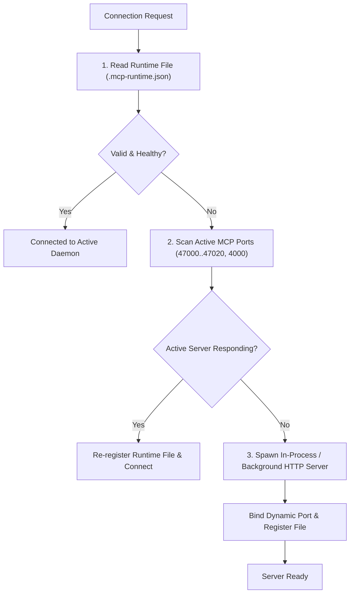

# Runtime Resilience and Connection Lifecycle

## 1. Connection Resolution Pipeline

When an AI agent or client invokes Local MCP Memory, the runtime establishes connectivity through a robust 4-stage resolution pipeline ([`core/config/connectionResolver.js`](file:///C:/Code_Works/HTML_CSS_JS/workProjects/projects/local-mcp-memory/core/config/connectionResolver.js)):



---

## 2. Windows Lock Engine Resilience & Dead-PID Recovery

### The Stale Lock Problem
In multi-agent environments, processes frequently terminate abruptly (e.g. timeout, SIGINT, or IDE termination). Previous implementations relied on comparing file modification time (`mtimeMs > 30000`), but since startup lock acquisition timeout was 5,000ms, a dead process holding a lock created 2 seconds prior would block all subsequent processes for 30 seconds, causing continuous `Failed to acquire lock: startup` crashes.

### The Remediation
1. **Payload Inspection:** Lock files now store JSON metadata:
   ```json
   {
     "pid": 26020,
     "createdAt": 1793880448987
   }
   ```
2. **PID Liveness Check:** Before waiting on retry delays, `acquireFileLock` reads the lock file and queries `isValidPID(lockData.pid)`.
3. **Cross-Platform PID Verification:**
   - On POSIX: `process.kill(pid, 0)` throws `ESRCH` when the process is dead.
   - On Windows: Node maps absent processes to `ESRCH` and protected system processes to `EPERM`.
   - If the PID is dead, the stale lock file is unlinked immediately and acquisition succeeds without delay.

---

## 3. Port Negotiation & Cross-Project Isolation

1. **Port Allocation Range:**
   - Standard range: Ports `47000` through `47020`.
   - Legacy fallback: Port `4000`.
   - `PortManager` verifies socket availability (`net.createServer().listen(port, '127.0.0.1')`) and tests connectivity before assignment.

2. **Port Mismatch Protection in `server.js`:**
   - When a caller requests a specific port (e.g. `PORT=3799` during testing or isolated execution), the server compares `runtimeFromFile.port === requestedPort`.
   - If the existing runtime is on a different port, it is not mistakenly reused.
   - When reusing an existing instance, the server explicitly writes `MCP Server running on port <port>` to stderr so automated supervisors and client drivers unblock immediately.

3. **Multi-Project Isolation:**
   - Runtime files are scoped to project directories: `<project-name>.mcp-runtime.json`.
   - When multiple workspaces run concurrently on the same host, each binds to its own isolated port and database scope while respecting global coordination boundaries.
