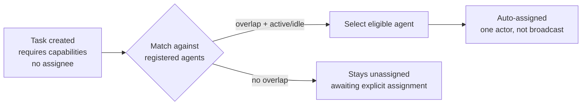

# Agent Capabilities

Capabilities are an agent's **declared skills**, used to route work to the right actor.
They are a coordination contract, not decoration.

## What capabilities are

- A list of skill labels declared at registration (and updatable on re-registration).
- Matched against the capabilities a task requires; overlap drives
  [capability-based auto-assignment](../orchestration/task-model.md).
- Distinct from **permissions**: a capability says "I can do this kind of work"; a
  permission says "I am allowed to." The system's coordination surface deals in
  capabilities; the security surface deals in permissions — see
  [security-model](../security/security-model.md).

## Honest advertisement is a contract

The system's design principles treat honest capability advertisement as binding: **declare
only what you actually do.** Two levels reinforce this:

1. **Agent level**: an agent that declares capabilities it lacks will be auto-assigned work
   it cannot complete — the routing system has no way to second-guess declarations.
2. **Protocol level**: the same principle governs the MCP tool surface — the server
   deliberately withholds advertising capabilities it hasn't implemented (a decision
   recorded in [architectural-decisions](../governance/architectural-decisions.md)).

Overclaiming degrades the whole coordination layer; underclaiming just routes work
elsewhere. Err toward underclaiming.

## How routing uses capabilities

Rules (Confirmed):

- Auto-assignment fires **only** when a task declares required capabilities and has no
  assignee.
- Matching requires **declared overlap** between task requirements and agent capabilities.
- **Offline agents are excluded** (derived presence governs — see [heartbeat-model](heartbeat-model.md)).
- Assignment picks **one** eligible actor (claim-once spirit) — never a broadcast.
- Explicit human/agent assignment always wins over auto-matching; auto-assign never
  overrides an existing owner.

## Relationship to tasks and roles

- **Role** is a coarse label ("analyzer", "db-specialist"); **capabilities** are the
  fine-grained matching surface. Roles aid readability; capabilities drive routing.
- Tasks that don't declare capabilities are never auto-assigned — they await explicit
  ownership ([orchestration-principles](../orchestration/orchestration-principles.md)).

## Anti-patterns

- Declaring everything ("full-stack everything") — you become the default owner of work
  you can't finish.
- Relying on capability matching for correctness — it is a routing convenience; ownership
  is still established by the assignment/claim itself.
- Mutating another actor's declared capabilities — capabilities are self-declared at
  registration.

## Invariants

- Routing matches declared requirement/declared capability overlap only.
- Offline agents never receive auto-assigned work.
- Auto-assignment assigns exactly one eligible actor, never broadcasts.
- Explicit assignment always outranks auto-matching.

## Evidence

- `utils/coordinationEngine.js` — capability matching, active-only selection, one-assignee rule
- `core/mcp/models.js` — agent capability fields
- `mcp-server.js` — protocol-level honest-advertisement decision
- `tests/multi-agent-coordination-test.js` — routing behavior

**Status:** Confirmed (matching rules, exclusion, single-assignee); capability vocabulary
itself is **open** (free-form labels, no fixed taxonomy).
