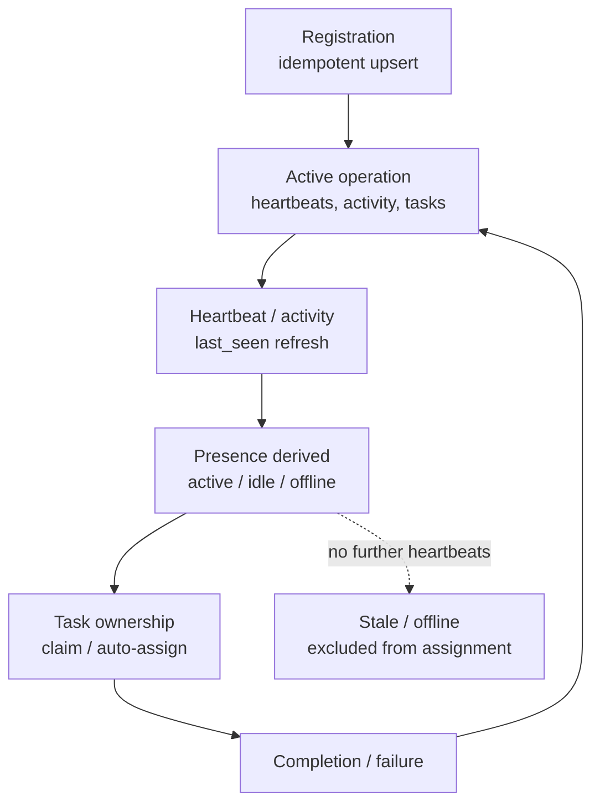

# Agent Model

The conceptual lifecycle of an actor in this system: identity, registration, presence, and
completion. An _agent_ is any actor operating through the system — the model makes no
assumptions about vendors, models, or human-vs-machine (there is no type distinction on
coordination routes).

## Lifecycle

## Identity

- Identity is a **stable agent id** (an id chosen and reused by the agent's host), plus
  project + scope attribution stamped from **trusted server configuration** on the MCP
  path.
- Identity comes from configuration, never from caller claims where a trusted source
  exists — the execution domain formally rejects caller-supplied identity, and the MCP
  tool layer injects it before dispatch (see [design-principles](../foundation/design-principles.md) §1).
- Project rules forbid operating with the reserved fallback values (`agent=unknown`,
  `project=default`): these are treated as **misconfigurations**, not identities. The
  storage layer keeps them as column defaults purely as a last-resort schema fallback.

## Registration

Registration is an **idempotent upsert**: same identity → refreshed record, not a new
entity. It declares:

- **Identity** — the stable agent id
- **Role** — a human-readable role label
- **Capabilities** — skills for routing (see [agent-capabilities](agent-capabilities.md))
- **Status** — declared state, though _derived_ presence governs real availability

Re-registration is safe and expected (each new session re-announces itself). The registry
persists across restarts — agent records are durable project state, not runtime state.

## Status (derived, not trusted)

Availability status is **derived from last-seen age**, recomputed lazily on access — it is
never trusted from callers. Three states:

| Status    | Meaning                                                                                                                           |
| --------- | --------------------------------------------------------------------------------------------------------------------------------- |
| `active`  | Recently present (heartbeat/activity within the active threshold)                                                                 |
| `idle`    | Present but quiet (within the offline threshold)                                                                                  |
| `offline` | No presence beyond the staleness threshold (~45s active / ~120s offline per current implementation — **implementation-specific**) |

A declared status on the record is informational; **derived presence governs** assignment
and coordination decisions. See [heartbeat-model](heartbeat-model.md).

## Ownership and completion

- Agents take ownership explicitly: task claims ([claim-once](../collaboration/multi-agent-coordination.md)),
  lock acquisition, auto-assignment via capability overlap.
- A task's status transition updates the owning agent's `current_task` linkage — the agent
  record reflects live work.
- **Completion / failure**: tasks reach completed/blocked states; issues get resolved
  explicitly. There is no forced "deregistration" ceremony — an agent that stops
  heartbeating simply ages into offline/stale.
- **Disappearance is expected and handled**: stale actors are excluded from new
  assignments; their claims age out (lock TTL); their unfinished tasks remain visible for
  reassignment.

## Coordination with other agents

- Presence answers "who is here?"; activity answers "what did they do?"; messages carry
  handoffs. The three together are the coordination surface — see
  [multi-agent-coordination](../collaboration/multi-agent-coordination.md).

## Invariants

- Identity is stamped from trusted configuration; fallback identities are misconfigurations.
- Registration is idempotent (upsert, never duplicate entities).
- Availability is derived from last-seen, never asserted.
- Offline agents receive no new auto-assigned work.

## Evidence

- `utils/coordinationEngine.js` — registration upsert, derived status, presence filtering
- `core/mcp/models.js` — agent model, status enum
- `src/core/database/sqlite/schema.js` — universal attribution columns
- `tests/persistent-agent-registry-test.js`, `tests/multi-agent-coordination-test.js` — behavior

**Status:** Confirmed (lifecycle, idempotent registration, derived presence); exact
staleness thresholds are **implementation-specific**.
