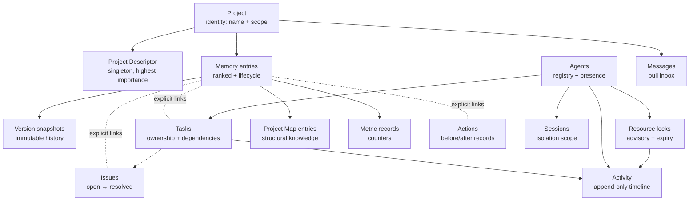

# Context Model

Conceptual entities and their relationships — independent of physical table names. Tables
are implementation evidence, not the model.

## Entity rules

| Entity       | Identity                              | Ownership / scope                                    | Lifecycle                               | History                               |
| ------------ | ------------------------------------- | ---------------------------------------------------- | --------------------------------------- | ------------------------------------- |
| Project      | slug-like name, resolved by hierarchy | owns everything below                                | persists                                | —                                     |
| Descriptor   | one per project (upsert)              | project scope, type=project                          | never decayed                           | versioned snapshots                   |
| Memory entry | opaque id + explicit link arrays      | private / project / global scope + agent attribution | draft→active→deprecated→archived        | version integer + immutable snapshots |
| Task         | opaque id + natural task key          | project-scoped; single owner (`assigned_to`)         | pending→in_progress / blocked→completed | activity trail                        |
| Issue        | opaque id + natural issue key         | project-scoped                                       | open→resolved                           | activity trail                        |
| Activity     | opaque id                             | project-scoped (actor recorded)                      | append-only; no edits                   | _is_ the history                      |
| Lock         | (project, resource) held by one owner | project-scoped                                       | acquired→released/expired               | mirrored to activity                  |
| Agent        | stable agent id                       | project-scoped                                       | registered→present/stale                | activity + metrics                    |
| Project map  | one entry per (project, path)         | project-scoped                                       | upserted/refreshed                      | `last_verified_at`                    |
| Metric       | record per event                      | project-scoped                                       | append-only                             | reset-pruned                          |
| Session      | session id                            | cross-cuts entities via scope filter                 | active→idle→disconnected→expired        | —                                     |

## Important identifiers

- **Opaque ids** everywhere (UUID-style) for records; **natural keys** (task key, issue key,
  lock key) coexist for human/lookup use.
- **Actor identity** = agent id + project (stamped at write).
- **Explicit link arrays** on memory/tasks/issues (related memory/actions/tasks/issues/
  agents, `conflictsWith`) form the context graph — links are stored, never inferred.
- **Idempotency keys** on replayable creates (tasks, chat messages, execution jobs)
  enforced by unique indexes.

## Scoping model (two orthogonal axes)

1. **Visibility scope** (memory): `private` → own agent; `project` → same project;
   `global` → everyone. Anchor-based query filtering.
2. **Session scope**: per-session filters for isolation; strict mode rejects cross-session
   writes.

Plus a third, physical axis: **storage is shared** — one database file; project isolation
is _logical_ (column-scoped), enforced and tested, not physical partitioning.

## Derived vs recorded state

| Derived (system-computed, never trusted from callers) | Recorded (authoritative input)                |
| ----------------------------------------------------- | --------------------------------------------- |
| Agent status (active/idle/offline)                    | Agent identity, capabilities                  |
| Task priority score, schedule readiness               | Task title/description/priority, deps         |
| Effective task status after dependency check          | Explicit status transitions                   |
| Search rank                                           | Memory content, importance, links             |
| Warning set for a write                               | Expected version/timestamp supplied by caller |

## Versioning and historical state

- Every memory mutation bumps a per-record `version` and captures an immutable snapshot of
  prior state first (change reason + actor recorded).
- Activity is the append-only event history; metrics are the counter history.
- Conflict warnings are recorded as activity rows _linked back_ onto records via
  `conflictsWith` — history and current state stay connected.

## Entity-relationship notes (conceptual, not FKs)

Almost all relationships are **soft links** (stored id arrays), not foreign keys. Only two
hard referential constraints exist in storage (version rows cascade with their memory entry;
chat messages orphan-null when their room is deleted). This is a deliberate flexibility
choice: the graph tolerates cross-domain references without referential lock-step, while
idempotency and uniqueness constraints protect the high-risk write paths.

## Evidence

- `src/core/database/sqlite/schema.js` — tables, universal columns, indexes, FKs, idempotency
- `core/mcp/models.js` — entity models, enums, link arrays, query builder (visibility rules)
- `utils/memoryEngine.js` — versioning and lifecycle semantics
- `tests/multi-project-isolation-test.js`, `tests/session-isolation-test.js` — scoping claims
  (note: legacy/suite caveats documented in [validation-principles](../reliability/validation-principles.md))

**Status:** Confirmed (entities, identifiers, scoping); the "soft-links-by-design" rationale
is Inferred from schema structure (no explicit comment states it).
