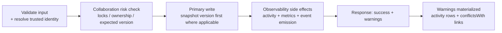

# Data Flow

How reads, writes, and events move through the system. Conceptual — route paths and
function names are implementation-specific.

## Write flow (canonical)

Every domain write follows the same shape (Confirmed across memory, descriptor, task,
issue, project-map routes):



Key ordering rules:

1. **Risk is evaluated, never enforced** for document writes — warnings are computed,
   the write proceeds, then warnings are returned _and_ persisted (activity +
   `conflictsWith` + metric).
2. **Version snapshot precedes mutation** for memory (non-fatal if snapshot storage hiccups).
3. **Observability follows the primary write** — a late side-effect failure surfaces as an
   HTTP error even though the primary row already committed (known partial-failure window;
   see [failure-model](../reliability/failure-model.md)).
4. **Hard errors** are returned as string `error` bodies (→ MCP-layer tool failure);
   **advisory signals** ride `warnings[]` on success (never thrown).

## Read flow (search)

1. Sanitize the query (FTS operators and dangerous patterns stripped, length bounded).
2. Apply **anchor scoping** when agent/project context is present
   (private→self, project→same project, global→all). Unanchored reads (no anchor) skip the
   filter by documented design so bare queries see everything the caller's project wrote.
3. Full-text pre-filter, then **application-side ranking**: keyword overlap, importance,
   recency, access frequency, with lifecycle penalties (deprecated/archived) and a
   project-descriptor boost.
4. **Reads have write side effects**: hits increment access counters and trigger lifecycle
   re-evaluation (promotion/decay decisions are made during search).

## Event flow (after-effect chains)

| Event                               | Listeners (conceptual)                                                         |
| ----------------------------------- | ------------------------------------------------------------------------------ |
| `memory_updated`                    | content-conflict detection/resolution; lifecycle evaluation; activity + metric |
| `task_created`                      | capability auto-assignment (when capabilities declared and unassigned)         |
| task status transitions             | agent `current_task`/status synchronization; completion metric                 |
| collaboration-checked writes        | warning materialization (activity + conflictsWith + metric)                    |
| lock ops, registrations, heartbeats | activity + metrics (implicit audit trail)                                      |

Events are **in-process and best-effort-adjacent**: listeners run during the request, not
on a background worker. There is no job queue; there are no timers driving coordination
behavior (lock expiry, staleness, and retention are all lazy or reset-triggered).

## MCP → backend flow

```text
tool call
  → validate arguments (structured INVALID_INPUT on failure)
  → classify call (safe-retry allow-list? read or write?)
  → HTTP request to embedded backend (bounded timeout)
       ↳ retry only safe/read-shaped calls on timeout/network/upstream
       ↳ circuit breaker fails fast when backend repeatedly unavailable
  → map backend body:
       {error} or {success:false,error} → throw → JSON-RPC -32603
       {success:true, warnings[]}      → advisory result (warnings surfaced in text)
```

Writes are deliberately single-attempt (never auto-retried).

## Identity flow

Resolved once (project marker files > global config > environment > fallback), injected
into every MCP-originated request as `agent`/`project`/`scope`, stamped onto records at
write time. Persistence defaults (`unknown`/`default`) exist as column fallbacks but are
considered misconfigurations by project rules — see
[project-identity](../projects/project-identity.md).

## Persistence durability flow

- WAL journal + foreign keys ON + busy timeout → concurrent writers serialize safely.
- Duplicate-key retries are bounded (idempotent-create paths retry a few times, then fail).
- Full-text indexes are maintained by triggers and repaired on boot if drifted.
- Schema upgrades are existence-gated and additive.

## Evidence

- `server.js` — risk-check → write → tracking → warnings ordering across seven routes
- `utils/collaborationEngine.js` — warn-only risk evaluation
- `utils/memoryEngine.js` — snapshot-first writes, event listeners
- `mcp-server.js` — retry classification, circuit breaker, error mapping
- `src/core/database/sqlite/schema.js`, `connection.js` — triggers, pragmas, migrations

**Status:** Confirmed (all flows cited); "no background queue/timers" is Confirmed by
absence across entry points (Inferred strength: strong negative evidence).
