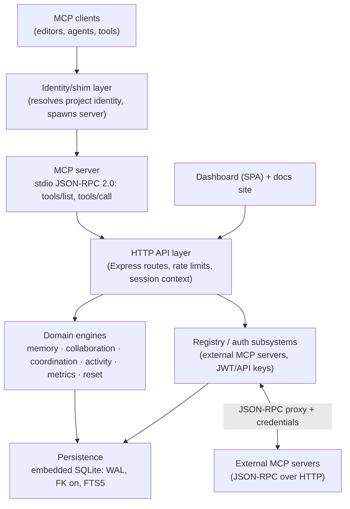

# System Architecture

Conceptual layering of Local-MCP-Memory. Deliberately independent of current file names;
current entry points are noted only in the implementation subsection.

## Layers

### 1. Client + identity layer

- **Purpose**: connect editors/agents to the server; resolve trusted project/agent identity
  before any work happens.
- **Owns**: identity resolution inputs (project marker files, global config, environment).
- **Invariants**: identity hierarchy is project-file-first; runtime discovery files are
  validated, never trusted blindly. See [project-identity](../projects/project-identity.md).

### 2. MCP server (protocol layer)

- **Purpose**: expose tools over MCP stdio JSON-RPC; translate tool calls into backend HTTP
  calls; embed the reliability envelope (timeout, safe retry, circuit breaker, validation,
  structured errors).
- **Owns**: tool contracts, argument validation, protocol errors, tool composition (base +
  feature-gated + registry + execution + dynamically discovered proxied tools).
- **Must not own**: business logic or storage — it is a protocol/translation layer.
- **Invariants**: stdout carries JSON-RPC only; writes are never auto-retried; invalid input
  is rejected before execution with a structured code. See [tool-contracts](../mcp/tool-contracts.md).

### 3. HTTP API layer

- **Purpose**: the single business surface used by both the MCP layer and the dashboard:
  routes for memory, coordination, agents, registry, health, metrics, ops.
- **Owns**: request validation, collaboration-risk evaluation, response shaping (success +
  warnings vs error), rate limiting, session context.
- **Must not own**: persistence internals (delegated to the persistence layer).
- **Invariants**: document writes happen _then_ warnings are surfaced; string-`error`
  responses signal hard failure to the MCP layer. See [data-flow](data-flow.md).

### 4. Domain engines

Thin, single-purpose services over persistence: **memory** (versions, lifecycle, conflict
resolution), **collaboration** (locks, risk evaluation, warning tracking), **coordination**
(agents, task scheduling/assignment), **activity**, **metrics**, **reset** (confirmed
cleanup). Each owns one kind of state and emits observability as a side effect.

### 5. Persistence layer

- **Purpose**: durable embedded SQLite behind a Mongo-compatible collection API (query
  builder, FTS5 translation, duplicate-key compatibility, additive migrations).
- **Owns**: schema, indexes, full-text sync triggers, transaction primitives, FK enforcement.
- **Invariants**: additive-only evolution; automatic index repair; idempotency keys enforced
  by unique indexes. See [context-model](context-model.md).

### 6. Cross-cutting subsystems

| Subsystem                             | Purpose                                                                                                                  |
| ------------------------------------- | ------------------------------------------------------------------------------------------------------------------------ |
| Auth                                  | JWT/API-key authentication and roles — applied to registry routes; core routes are local-first/unauthenticated by design |
| MCP registry                          | Catalog + health + JSON-RPC proxying of _external_ MCP servers with encrypted credentials and per-server breakers        |
| Session layer                         | Per-session visibility and lifecycle (active/idle/disconnected/expired) for isolation of reads/writes                    |
| Dashboard                             | Same-origin SPA over the HTTP API for human visibility (memory, tasks, locks, activity)                                  |
| Execution sandbox _(opt-in, Phase 1)_ | Job lifecycle, policy, hash-bound approvals, redacted audit — refuses to execute without Docker isolation (fail-closed)  |
| Reliability envelope                  | Timeouts, retry classification, circuit breakers, health endpoints, chaos hooks                                          |

## Entry points (implementation-specific, as of last review)

- MCP stdio server: `mcp-server.js` (spawned via `mcp-shim.js` for editor integrations)
- HTTP backend: `server.js` (also hosts the dashboard routes)
- Dashboard: same HTTP server (`/dashboard` SPA)
- Persistence: embedded SQLite file (single database, logical project scoping)

> **Structural tension (observation, as of 2026-10):** the repository contains a _second_,
> unwired service layer (`src/domains/*` + `src/interfaces/api/routes.js`) alongside the
> live `server.js` + `utils/*` engines, with divergent collaboration semantics. Verify which
> layer a code path uses before changing behavior. See
> [component-responsibilities](component-responsibilities.md) and
> [change-guidelines](../governance/change-guidelines.md).

## Evidence

- `mcp-server.js`, `server.js`, `mcp-shim.js` — layer boundaries and entry points
- `utils/*Engine.js` — domain engine set
- `src/core/database/sqlite/*` — persistence contract
- `src/core/session/*`, `src/core/auth/*`, `src/core/mcp-registry/` — cross-cutting subsystems
- `docs/reliability.md` — reliability envelope documentation

**Status:** Confirmed (layers and boundaries); the dual-layer note is a Confirmed observation
of current structure; its intent is **Unknown** (see [architectural-decisions](../governance/architectural-decisions.md)).
