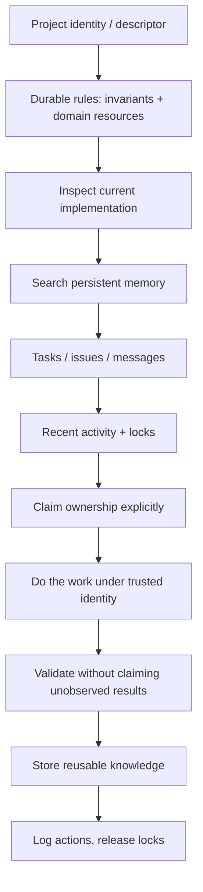

# AI-Agent Reading Guide

How an AI agent should reason about an unfamiliar repository **using** Local-MCP-Memory —
both when working _on_ this project and when working _with_ it as a coordination backend.

The goal of this guide is to teach a thinking order, not a file list.

## Phase A — Understand before touching (local repository work)

1. **Project identity**
   Read the project descriptor (purpose, category, stack, goals, constraints, rules) before
   making architectural assumptions. If it is missing or stale, update it via the descriptor
   tools rather than improvising.
2. **Durable rules**
   Read this resource layer's [invariants](../governance/invariants.md) and the relevant
   domain resource. Know what must not break before forming a plan.
3. **Current implementation**
   Then read actual code for the area you will change. Code is executable truth; documents
   are only as good as their last review.
4. **Repository conventions**
   Check `AGENTS.md`/`BEHAVIOR.md` and governance docs for session-level rules (commit
   policy, report placement, test commands).

## Phase B — Establish shared state (coordination work)

5. **Search persistent memory/context** for prior decisions, bugs, constraints, architecture.
   Prefer high-importance, recent, project-scoped entries; treat lifecycle labels as signal.
6. **Inspect active tasks, issues, and messages** — avoid duplicating work; respect
   ownership; pick up handoffs.
7. **Inspect recent activity** to understand what other actors just did (and whether a
   human is active in your area).
8. **Check collaboration signals** — active resource locks and any recorded conflict
   warnings for the resources you intend to touch.
9. **Claim explicitly** — acquire relevant locks, claim tasks (claim-once), announce intent
   through activity/messages when the work is shared.

## Phase C — Work, validate, record

10. **Perform the work** within the identity you resolved (never impersonate another agent).
11. **Validate** using the repository's verification path (syntax checks, targeted suites,
    full gate where required) — never claim a check passed without observing it.
12. **Record reusable knowledge** back into memory (decisions, constraints, fixes — not
    trivia) and update project maps if structural understanding changed.
13. **Record important actions** — meaningful activity entries, task status changes, issue
    resolutions, lock releases — so the timeline stays legible to everyone.

## Judgment rules

- **Conflicts**: surface them; never smooth them over silently. Overlap warnings are
  information — treat a changed-since-read resource as meaningful, and prefer the memory
  conflict order (importance → recency) when resolving duplicates.
- **Ownership**: if another actor owns the task or holds the lock, avoid overlap, communicate
  clearly, and proceed only when the change is still justified. Soft signals do not grant
  permission to ignore others — but they also never bar a human from their own project.
- **Evidence discipline**: distinguish Confirmed / Inferred / Unknown; never present a
  historical PID, test count, or report verdict as current without re-verification.
- **Reset/destructive operations**: require explicit confirmation codes; log everything you
  delete.
- **Commit/push**: only with explicit, current authorization — never infer it.
- **Where documents conflict with code**: code wins; fix the document
  ([change-guidelines](../governance/change-guidelines.md)).

## Anti-patterns

- Starting from implementation detail instead of purpose and invariants.
- Treating memory as a scratchpad (it is for durable knowledge only).
- Assuming advisory signals (locks, warnings) are either hard guarantees or ignorable —
  they are coordination requests.
- Duplicating work that an existing task or issue already owns.
- Claiming verification you did not personally observe.

## Evidence

- `agent-instruction.js`, `MCP_AGENT_INSTRUCTIONS.md`, `BEHAVIOR.md` — the documented
  before-work/during-work/after-work flow this guide formalizes
- `README.md` — system-mode usage flow (descriptor → memory → tasks → activity → locks → claim → change → store/release)

**Status:** Confirmed (flow matches documented agent instructions); sequencing of Phase C
validation is Inferred from repository practice (governance docs).
