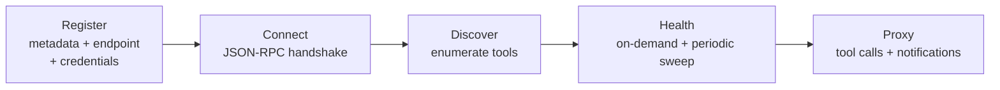

# MCP Server Registry

The registry lets this server **catalog, connect to, discover from, health-check, and
proxy** _external_ MCP servers — making their tools first-class tools of this server
without code changes. (Here "MCP servers" always means external ones; see
[mcp-role](mcp-role.md) on qualifying the term.)

## Lifecycle

### Registration

A server is registered with its identity, transport metadata, endpoint, and optional
credentials. Registration is **project-scoped with parity**: the same scoping applies
whether registered via MCP tools or HTTP routes — no surface is a scoping loophole.

### Connection and discovery

Connection performs a JSON-RPC handshake; discovery enumerates the external server's
tools, which are **cached in memory** and surfaced through the deterministic proxied-tool
naming convention (prefixed per server to prevent collisions — exact format is
implementation-specific). Dynamic tools participate in this server's tool list like any
other.

### Health

Health checking runs **on demand and on a periodic sweep**: a connected server that stops
responding is detected and marked, without requiring a client to stumble into it. Breaker
state and health status feed coordination decisions about whether to proxy calls.

### Proxying

Tool calls (and notifications) are forwarded as JSON-RPC to the external server over its
transport. **HTTP-based servers are proxyable; stdio-based servers are metadata-only** —
their tools are recorded but not proxied (no subprocess orchestration on this path).

## Credential handling (security-critical)

| Property                  | Behavior                                                                                                                                                                    |
| ------------------------- | --------------------------------------------------------------------------------------------------------------------------------------------------------------------------- |
| At rest                   | Credentials encrypted (AES-256-GCM class, key derived from the server master secret)                                                                                        |
| No key configured         | **Fail closed on read** — encrypted credentials are never silently decrypted as plaintext; a plaintext-degrade path exists for migration but **writes an explicit warning** |
| On every external surface | **Masked** — routes, tool output, and logs never echo stored credentials                                                                                                    |
| Failure                   | A server whose credentials can't be decrypted is unusable-but-safe, not usable-but-leaky                                                                                    |

The fail-closed asymmetry is the design: _convenience may degrade with warning; secrecy
never degrades silently._ See [security-model](../security/security-model.md).

## Per-server isolation

Each registered server gets **its own circuit breaker and timeout budget**: one failing
external server fails fast on its own ([reliability-model](../reliability/reliability-model.md))
without dragging healthy servers down. Health and breaker state are runtime (ephemeral —
see [knowledge-persistence](../memory/knowledge-persistence.md)); server rows are durable.

## Invariants

- Credential values are encrypted at rest and masked on every external surface.
- Decrypt-without-key fails closed; plaintext degrade warns explicitly.
- Breakers and health are per-server; failures don't cascade across servers.
- Registration scoping is identical across MCP and HTTP surfaces.
- Proxied tools are namespaced to prevent cross-server name collisions.

## Evidence

- `src/core/mcp-registry/` — registration, connection, health sweep, proxy, crypto
- `tools/mcpRegistryTools.js` — the registry tool group
- `tests/mcp-registry-test.js` — registry behavior including masking and fail-closed reads

**Status:** Confirmed (lifecycle, masking, fail-closed, per-server isolation); exact
naming convention and crypto parameter details are **implementation-specific**.
