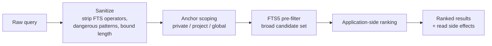

# Context Retrieval

How knowledge is found, ranked, and expanded. Retrieval is a **two-stage pipeline**:
storage-level pre-filtering, then application-side ranking.

## Search pipeline

### 1. Sanitization

Queries are normalized before touching the index: full-text operators and dangerous
patterns are stripped and length is bounded. Malformed or hostile queries degrade to safe
behavior rather than raw index syntax.

### 2. Anchor scoping

When agent/project context is present, results are filtered by memory **visibility scope**:

| Anchor sees | Entries                |
| ----------- | ---------------------- |
| private     | Own agent's entries    |
| project     | Same project's entries |
| global      | Everything             |

Unanchored reads (no anchor) **intentionally skip** the filter — a documented choice so
bare queries see everything the project wrote. Session scope applies orthogonally; strict
session isolation rejects cross-session writes.

### 3. Full-text pre-filter

An FTS5 index (maintained by triggers, repaired at boot if drifted) produces the candidate
set. The index is a _pre-filter_ — it narrows, it does not rank.

### 4. Application-side ranking

Ranking is computed above storage, combining:

- **Keyword overlap** — relevance of matched terms
- **Importance** — the record's ranking weight (descriptor gets the top boost)
- **Recency** — newer entries favored
- **Access frequency** — frequently retrieved knowledge rises
- **Lifecycle penalties** — `deprecated`/`archived` entries ranked down but not hidden

Keeping ranking in application code (rather than SQL scoring) keeps the model portable and
tunable, at the cost of fetching candidates before final ordering.

## Read side effects

Retrieval is not a pure operation:

- Hits **increment access counters** (feeding future ranking).
- Retrieval can **trigger lifecycle re-evaluation** (promotion/decay decisions happen
  during search — the system has no background jobs, so reads are the natural evaluation
  point).

Side effects are best-effort-adjacent: they must not corrupt the read result.

## Expansion (connected context)

Two complementary retrieval shapes exist:

- **Full context by id** — one entry plus its connected context.
- **Connected context** — expansion through the **explicit link arrays** (related memory,
  tasks, issues, actions, versions, related agents) and the project descriptor.

The context graph is _stored, never inferred_: if two records are related, a link says so.
This makes expansion predictable and cheap, and keeps the model explainable — see
[memory-model](memory-model.md).

## Consistency expectations

- Search reflects committed state; there is no cross-request cache of results.
- Reads may be retried on timeout/network/upstream failure (safe-retry allow-list);
  the access-count side effect means a retried read can double-count — an accepted,
  documented trade-off (reads are classified safe because ranking tolerates it).
- Search never returns cross-project leakage when anchored (isolation is enforced and
  tested; see [validation-principles](../reliability/validation-principles.md) for caveats
  about which suites are wired into which gates).

## Anti-patterns for callers

- Trusting search order as authority over **importance** — check importance and lifecycle
  explicitly for decision-critical knowledge.
- Assuming unanchored reads are filtered — they are not; anchor when isolation matters.
- Treating retrieval as free — every hit changes counters and may change lifecycle labels.

## Evidence

- `utils/memoryEngine.js` — sanitization, ranking factors, side effects
- `src/core/database/sqlite/schema.js` — FTS5 index + triggers + boot repair
- `core/mcp/models.js` — visibility rules / anchor-based query builder
- `tests/integration-modules-test.js`, `tests/multi-project-isolation-test.js` — retrieval behavior

**Status:** Confirmed (pipeline, factors, side effects); specific scoring weights are
**implementation-specific** and intentionally not duplicated here.
