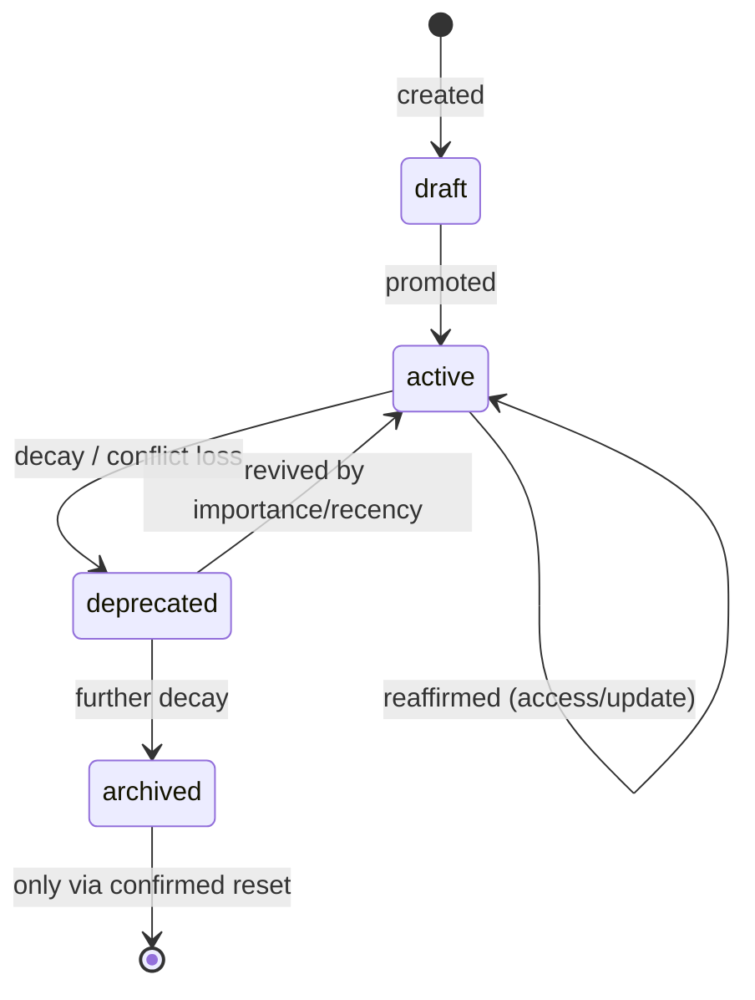

# Memory Lifecycle

How knowledge enters, ages, and exits the store — **without ever silently disappearing**.

## Lifecycle states

| State        | Meaning                                                          |
| ------------ | ---------------------------------------------------------------- |
| `draft`      | Newly captured, not yet affirmed as established knowledge        |
| `active`     | Current, usable knowledge (the normal steady state)              |
| `deprecated` | Known-stale or superseded — kept for history, ranked down        |
| `archived`   | Long-inactive or low-value — heavily ranked down, still retained |

Transitions are **labels, not deletions**. Archived and deprecated entries remain readable
and versioned.

## Transitions and evaluation

- **Lazy evaluation**: lifecycle decisions are evaluated during search/retrieval and on
  update — there are no background jobs or timers in this system. A record's lifecycle
  changes only when something touches it.
- **Promotion** (`draft → active`, or reviving a ranked-down entry): driven by importance
  and recency signals — recent, high-importance, frequently-accessed knowledge stays active.
- **Decay** (`active → deprecated → archived`): age + low importance/access push entries
  down. Decay is a pure relabel; it never removes rows.
- **Conflict-driven deprecation**: when two entries share a key but differ in content, the
  update event resolves the conflict automatically — the lower-ranked entry is deprecated
  under the resolution order **importance → recency** (the documented tiebreak order).
- **Exemptions**: the project descriptor (special highest-importance entry) is exempt from
  decay; it must not age out — see [project-descriptors](../projects/project-descriptors.md).

## Version history

Every accepted mutation:

1. Captures an **immutable snapshot** of the prior state first (change reason + actor).
2. Bumps the record's monotonic `version` integer.

Version numbers are **per-record**, not global. Snapshots are non-fatal side effects: a
storage hiccup during capture is surfaced but must not block the primary write.

## Lifecycle in retrieval

Lifecycle is a ranking input, not a filter: deprecated/archived entries take ranking
penalties but remain searchable. This preserves history-driven retrieval ("what did we
decide before, even if superseded?") while favoring current knowledge. See
[context-retrieval](context-retrieval.md).

## What is deliberately absent

- **No automatic deletion.** Deletion exists only through confirmed, logged reset levels
  (escalating cleanup tiers; the most destructive require a literal confirmation code).
- **No scheduled maintenance jobs.** There is no queue, no cron-equivalent; retention
  cleanup happens lazily or via reset.
- **No overwrite-in-place.** Supersession is expressed through versioning and lifecycle
  labels so history stays connected to current state.

## Invariants (see [invariants](../governance/invariants.md))

- Memory decay relabels; it never deletes.
- Version snapshots precede mutation; snapshots are immutable.
- Conflict resolution is automatic but _visible_ (deprecation + recorded warnings/activity).
- The project descriptor never decays.

## Evidence

- `utils/memoryEngine.js` — lifecycle evaluation, decay/promotion, conflict-driven deprecation
- `src/core/database/sqlite/schema.js` — lifecycle column, version snapshots table
- `utils/resetEngine.js` — the only deletion path (confirmation-gated, logged)
- `tests/conflict-detection-test.js` — conflict resolution behavior

**Status:** Confirmed (states, lazy evaluation, no-delete semantics); exact promotion/decay
thresholds are **implementation-specific** and intentionally not pinned here.
