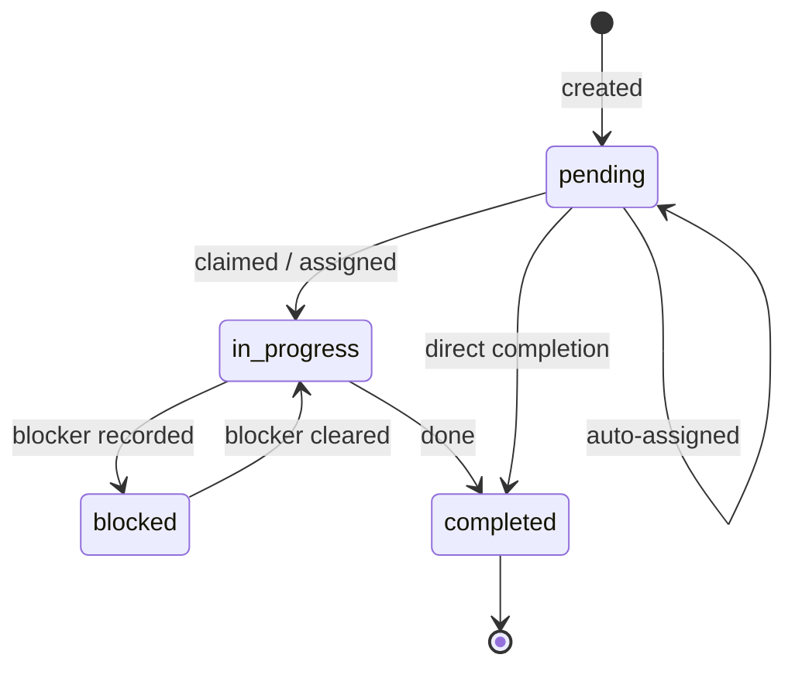

# Task Model

Tasks are the **coordination backbone**: the unit of shared work with explicit ownership,
status, priority, and dependencies. Project rules: _create tasks for multi-step or shared
work; update them when status, blockers, ownership, or results change._

## Task lifecycle

Statuses are explicit and transitioned by actors (pending / in_progress / blocked /
completed — exact enum is implementation-specific). There is no deadline-driven
expiration; tasks do not lapse on their own.

## Ownership and claiming

- **Explicit ownership**: `assigned_to` names a single owner.
- **Claim-once**: concurrent claims resolve to exactly one winner; the loser is refused
  (hard-block exception — a correctness boundary). See
  [multi-agent-coordination](../collaboration/multi-agent-coordination.md).
- **Auto-assignment** fires only when a task declares required capabilities and has no
  assignee — one eligible, non-offline agent is picked by declared overlap
  ([agent-capabilities](../agents/agent-capabilities.md)). Explicit assignment always wins.
- **Reassignment** is explicit — nothing reassigns silently; offline ownership is a signal
  for humans/agents to reassign, not an automatic trigger.
- **Idempotency**: creates carry a natural task key enforced by unique index — replayed
  creates return the same task rather than duplicating work.

## Derived state (never trusted from callers)

| Derived                | Inputs                                                                                         |
| ---------------------- | ---------------------------------------------------------------------------------------------- |
| **Priority score**     | Base priority, age, capability fit, dependency readiness (weights are implementation-specific) |
| **Schedule readiness** | Dependency graph — a task is ready when its dependencies are satisfied                         |
| **Effective status**   | Status after dependency evaluation (e.g. pending-with-unmet-deps reads as not-ready)           |

There are **no timers and no deadline fields driving scheduling**: "scheduling" here means
dependency-readiness plus priority ordering. Time-sensitivity is expressed through
priority and explicit updates, not through clock-triggered transitions.

## Dependencies

Tasks may depend on other tasks; dependencies feed both readiness (above) and the derived
priority. Dependency edges are explicit records — the graph is stored, never inferred
([design-principles](../foundation/design-principles.md) §11).

## Updates and conflict semantics

Task updates run through the canonical write flow: collaboration risk evaluation (foreign
ownership → warning in the live layer), versioning, activity recording. The dormant
service layer treats non-owner updates as a block — verify which layer a path uses
before extending ([extensibility](../architecture/extensibility.md)).

## Failure and blockers

- A stalled task gets an explicit `blocked` status plus (typically) a linked
  [issue](issue-model.md) recording the blocker.
- Completion, failure, and blockers all land in the activity stream, keeping the timeline
  honest for actors who weren't watching.
- Orphaned work (owner gone offline) stays visible — the system never auto-reaps or
  auto-reassigns.

## Invariants

- Claim-once: exactly one owner per claimed task.
- Auto-assign picks one eligible, online agent; explicit assignment outranks it.
- Scheduling derives from dependency readiness + priority; no hidden timers.
- Task creates are idempotent under their natural key.

## Evidence

- `utils/coordinationEngine.js` — claim-once, auto-assign, derived priority/readiness
- `core/mcp/models.js` — task model, statuses, query builder
- `src/core/database/sqlite/schema.js` — natural-key uniqueness (idempotency)
- `tests/multi-agent-coordination-test.js`, `tests/conflict-detection-test.js` — behavior

**Status:** Confirmed (lifecycle, claim-once, derived state, no-timer scheduling); exact
status enum and scoring weights are **implementation-specific**.
